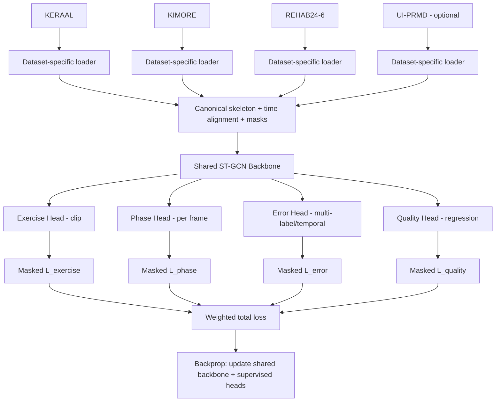

# Multi-Task Learning for Rehabilitation Exercise Analysis

> **README / Implementation Plan — phiên bản 1.0 (08/10/2026)**  
> Mục tiêu: xây dựng **một hệ thống** phân tích skeleton chuyển động với **1 shared backbone + 4 task heads**: Exercise Classification, Phase Detection, Error Type Detection và Movement Quality Assessment.  
> Trạng thái: **thiết kế nghiên cứu**, chưa phải kết quả đã huấn luyện hay benchmark được kiểm chứng.

## 0. Tóm tắt quyết định thiết kế

- **Đầu vào chuẩn:** chuỗi skeleton 3D theo thời gian, cộng `joint_mask`, `frame_mask` và metadata dataset. Không bắt buộc video RGB ở bản đầu.
- **Backbone ban đầu:** ST-GCN (hoặc temporal GCN đơn giản). Chỉ thử GAT/Transformer sau khi có baseline ổn định.
- **Bốn đầu ra:** (1) nhãn bài tập của toàn clip; (2) nhãn phase **theo frame**; (3) loại lỗi ở cấp clip và, khi có annotation, cấp thời gian; (4) điểm chất lượng ở cấp clip.
- **Dữ liệu chính:** KERAAL cho exercise + error; KIMORE cho exercise + quality; REHAB24-6 cho exercise + **mốc repetition** để **xây dựng, kiểm định** phase label. UI-PRMD là dataset bổ sung, **không bắt buộc ở bản MVP**.
- **Cách huấn luyện:** mỗi batch chỉ tính loss cho task **có ground-truth hợp lệ**; gộp loss, backprop **một lần** để cập nhật backbone và các head nhận nhãn.
- **Cảnh báo nghiên cứu:** việc chia sẻ backbone không bảo đảm tăng độ chính xác. Phải so sánh với single-task baselines và đánh giá rủi ro domain shift / negative transfer.

## 1. Bốn task học cái gì?

| Task | Cấp dự đoán | Input từ backbone | Output/Head | Giám sát & Loss gợi ý | Metric |
|---|---|---|---|---|---|
| **T1. Exercise Classification** | Clip/repetition | Temporal pooling của đặc trưng | Softmax `num_exercises` | `CrossEntropyLoss` | Macro F1, balanced accuracy, confusion matrix |
| **T2. Phase Detection** | **Frame** | Chuỗi đặc trưng `[T,D]` | Temporal decoder → logits `[T,num_phases]` | Masked frame-wise CE; tùy chọn smoothing/boundary loss | Frame macro F1, edit score/segment F1, boundary error |
| **T3. Error Type Detection** | Clip, có thể frame/interval | Pooled + temporal features | Sigmoid multi-label hoặc softmax tùy ontology | BCEWithLogits cho multi-label; CE khi nhãn mutually exclusive; mask unknown | Macro F1, per-error F1, mAP; temporal IoU nếu có |
| **T4. Movement Quality Assessment** | Clip/repetition | Temporal pooling | Regression score (tùy chọn ordinal head) | Huber/MAE hoặc MSE, **chỉ trên thang điểm hợp lệ** | MAE, RMSE, Spearman/Pearson |

**Quan trọng:** Task 2 là *phase bên trong chuyển động* (ví dụ raising/hold/lowering), **khác** việc biết lúc nào bắt đầu/kết thúc một repetition. REHAB24-6 có nhãn repetition boundary, **không có sẵn nhãn phase chi tiết được xác nhận**.

### Ví dụ output của một mẫu (minh họa, không phải nhãn gốc)

```json
{
  "exercise": {"label": "arm_abduction", "confidence": 0.94},
  "phase_per_frame": ["raise", "raise", "hold", "lower", "lower"],
  "errors": [{"type": "limited_range_of_motion", "confidence": 0.82}],
  "quality": {"score": 72.5, "scale": "0-100", "calibrated": false}
}
```

Không phát ra `quality.score` như một điểm lâm sàng chính thức nếu chưa kiểm định/calibrate; nhiều bài tập có quy tắc chấm điểm khác nhau.

## 2. Dataset: dùng thế nào cho đúng?

| Dataset | Input hữu ích | Nhãn có thể dùng trực tiếp | Vai trò chính | Không được tự giả định |
|---|---|---|---|---|
| **KERAAL** | Kinect 3D skeleton, video, annotation XML | Tên bài tập; correct/incorrect; error label, body part, temporal error interval (đặc biệt Group 1A/2A) | T1 + T3; thử correctness phụ trợ | Không tự coi error label là quality score liên tục; không sẵn phase chi tiết |
| **KIMORE** | RGB/depth/skeleton và thông tin chuyển động | 5 loại bài tập và đánh giá từ chuyên gia | T1 + T4 | Không tự đồng nhất thang quality với dataset khác |
| **REHAB24-6** | 3D/2D skeleton, video; 30fps | Exercise, repetition start/end, correct/incorrect, direction | T1 + **tạo phase annotation cho T2** | Repetition boundary **không** phải nhãn phase |
| **UI-PRMD** (*optional*) | Kinect/Vicon trajectories | 10 loại bài tập; repetition được chia file | Bổ sung T1, pretrain/validation đầu vào | Không suy ra có sẵn error taxonomy, phase labels chuẩn |

**Phương án tối giản để ra MVP:** KERAAL + KIMORE; sau đó thêm REHAB24-6 khi hoàn tất phase labeling. UI-PRMD được dùng khi cần mở rộng classification hoặc thử robustness.

### Link gốc

- KERAAL: https://keraal.enstb.org/KeraalDataset.html — mô tả/annotation/code: https://github.com/nguyensmai/KeraalDataset
- KIMORE paper: https://doi.org/10.1109/TNSRE.2019.2923060 ; PubMed: https://pubmed.ncbi.nlm.nih.gov/31217121/
- REHAB24-6: https://zenodo.org/records/13305826
- UI-PRMD paper: https://doi.org/10.3390/data3010002

**Checklist trước khi train:** kiểm tra license/quyền sử dụng; tải README/annotation schema; chạy script inventory đếm subject, exercise, clip, frame, loss-label coverage; không đoán số khớp, cột, nhãn từ tên file.

## 3. Kiến trúc tổng thể



### Kích thước tensor thống nhất

- Canonical skeleton sample: `positions [T, V, 3]` với `V` = **tập khớp chung đã xác minh** (thí dụ **17 khớp**, không ép nếu khớp không thể mapping đáng tin cậy).
- Batch model: `x [B, C=3, T, V]`, `frame_mask [B,T]`, `joint_mask [B,T,V]` (hoặc mask theo V nếu joint missing cố định).
- `features = backbone(x, masks)` → frame embeddings `[B,T,D]` + clip embeddings `[B,D]` sau pooling có mask.
- `exercise_logits [B,N_ex]`; `phase_logits [B,T,N_phase]`; `error_logits [B,N_err]` (tùy chọn temporal `[B,T,N_err]`); `quality_pred [B,1]`.
- Các chiều T có thể khác nhau giữa samples; áp dụng padding cùng mask, hoặc dùng fixed-length windows **và giữ mapping mốc thời gian**.

### Vì sao 4 task học chung được?

Cả 4 đều dựa trên **cấu trúc không gian và diễn tiến theo thời gian của cơ thể** (tư thế, ROM, quỹ đạo, nhịp và ổn định). Shared backbone học representation này; head riêng học phép biến đổi thành output khác nhau. Không cần 4 task có cùng loss hoặc cùng bộ nhãn.

## 4. Làm sao đồng bộ các dataset? (điểm quan trọng nhất)

> **Đồng bộ không có nghĩa ép nhãn tất cả dataset giống nhau.** Có hai tầng: **đồng bộ biểu diễn đầu vào** và **giữ đúng miền/semantics của nhãn**.

### 4.1 Canonical schema duy nhất

Mỗi sample nên được đưa về một record chuẩn:

```python
sample = {
    "sample_id": "keraal_...",
    "dataset": "keraal",        # provenance
    "subject_id": "...",        # split grouping; không rò rỉ danh tính
    "exercise_local": "...",    # nhãn gốc
    "exercise_global": 3,      # mapping đã phê duyệt hoặc -1 nếu không map được
    "xyz": ...,                # float32 [T, V, 3]
    "timestamps": ...,         # seconds [T]
    "joint_mask": ...,         # bool [T,V]
    "frame_mask": ...,         # bool [T]
    "labels": {
        "exercise": 3,       # optional
        "phase": ...,        # int [T] hoặc missing
        "error": ...,        # vector/intervals hoặc missing
        "quality": ...       # scalar + scale_id hoặc missing
    },
    "label_masks": {
        "exercise": True,
        "phase": False,
        "error": True,
        "quality": False
    }
}
```

Không bao giờ dùng 0 để biểu diễn *missing label* nếu 0 cũng là một class hợp lệ. Phân biệt **lỗi không xảy ra** (`negative`, có nhãn) với **chưa được gán nhãn lỗi** (`unknown`, phải mask).

### 4.2 Chuẩn hóa input theo thứ tự

1. **Load nguyên trạng + giữ provenance**: original joint name, fps/timestamp, unit, hệ tọa độ, bên trái/phải, participant, camera/motion-capture source.
2. **Joint mapping**: viết bảng `dataset_joint -> canonical_joint` theo giải phẫu; không map index bằng cách đoán. Joint không có thì mask, không mặc định bằng `(0,0,0)` như dữ liệu thật.
3. **Coordinates**: xác định meter/mm; chuyển cùng đơn vị; root-center tại pelvis/hip và scale theo tỷ lệ cơ thể **chỉ nếu không phá hủy thông tin ROM quan trọng**. Lưu biến gốc phục vụ kiểm thử.
4. **Coordinate orientation**: thống nhất trục đứng, phía trước và bên trái/phải; xử lý handedness/mirroring, kiểm tra trên skeleton visualization.
5. **Temporal normalization**: dùng timestamps; resample về cùng tần số mục tiêu (ví dụ 30 Hz) với interpolation hợp lệ; không nội suy xuyên khoảng mất tracking lớn. Khi resample phải cập nhật time boundaries và frame labels.
6. **Segmentation**: tách clip/repetition/windows theo annotation phù hợp; không sử dụng label test để cắt dữ liệu theo cách không có lúc inference. Nếu dự đoán theo clip đã cắt, ghi rõ assumption inference.
7. **Missing values**: short-gap interpolation có threshold, còn lại dùng joint mask; log tỷ lệ thiếu và loại sample kém chất lượng theo tiêu chí đã định.
8. **Normalization statistics**: chỉ fit trên **train split**; reuse cho validation/test. Không chuẩn hóa cả dataset rồi mới split.
9. **Visual QA**: dựng animation 10–20 mẫu/dataset, kiểm tra chân/tay không bị đảo, hướng trục, nhãn và timestamps có khớp.

### 4.3 Đồng bộ nhãn Exercise

Lập `exercise_ontology.yaml` gồm `global_id`, `global_name`, `dataset`, `local_label`, `mapping_confidence`, `notes`. **Không gộp hai động tác chỉ vì tên gần giống**. Nếu bài tập tương đương sinh cơ học và hướng dẫn lâm sàng, mapping về một class; nếu không, giữ class riêng hoặc unknown. Cần báo cáo: **closed-set union taxonomy**, **shared-intersection subset**, hoặc **per-dataset classification heads**.

**Rủi ro:** Khi mỗi exercise class chỉ xuất hiện ở một dataset, mô hình có thể phân loại dựa trên **thiết bị/dataset** chứ không học chuyển động thật. Dùng dataset-stratified metrics và bài kiểm tra cross-dataset cho các động tác thực sự trùng nhau; ghi rõ giới hạn nếu không có class overlap đủ lớn.

### 4.4 Đồng bộ nhãn Error Type

KERAAL error labels có thể **phụ thuộc bài tập**. Tạo ontology: `(exercise_id, local_error_code) -> canonical_error_id`, giữ `body_part`, `severity`, `start_time`, `end_time`. Với lỗi đa nhãn, head Sigmoid và `BCEWithLogits`; mask **từng loại lỗi chưa được kiểm chứng**. Chỉ dùng clip-level error khi clip có annotation tổng; chỉ dùng temporal error khi có timestamp annotation.

### 4.5 Đồng bộ nhãn Quality

- **KIMORE** là nguồn quality chính. Đọc đúng score range và ý nghĩa từng exercise từ metadata.
- Bản baseline có thể train normalized score *theo quy tắc từng exercise* nhưng phải bảo toàn score gốc và `scale_id`; xuất báo cáo đánh giá trong **thang gốc**.
- KERAAL `correct/incorrect` **không tương đương** với clinical quality score. Nếu muốn tận dụng, tạo **auxiliary correctness head** riêng hoặc multi-task auxiliary objective, **không** tự gán quality=0/100.
- Nếu không kiểm chứng score giữa hai dataset là cùng construct và scale: **quality loss chỉ tính KIMORE**.

### 4.6 Phase: thiết kế annotation riêng

- **Đề xuất phase ban đầu:** `up/raise`, `hold/peak`, `down/lower`; thêm `rest/transition` chỉ khi có định nghĩa rõ. Squat tương ứng `descent`, `bottom`, `ascent` nên cần chuẩn hóa thành **phase chức năng** (`outbound`, `turning/hold`, `return`) và map semantics theo từng bài tập.
- **REHAB24-6 có repetition boundaries**, dùng để cô lập từng repetition. Phải **xây nhãn phase bên trong** bằng góc khớp chính, derivative/angular velocity, turning points và annotation video.
- Bước bắt buộc: viết **phase annotation guideline theo từng exercise** (joint, sign, thresholds, hold minimum, ngoại lệ); gán thủ công gold subset có ≥2 annotators nếu khả thi; đo inter-annotator agreement; chỉ sau đó dùng rule/weak labels cho phần còn lại.
- **Không** chia đều thời gian của một repetition thành 3 phase. **Không** đánh đồng phase với repetition index, correctness hay error interval.
- Huấn luyện: dùng `phase_label_source` = `manual` / `rule_reviewed` / `pseudo`; có thể hạ loss weight cho pseudo; phase metrics chính chỉ tính trên held-out **human-reviewed gold labels**.

## 5. Cách train chung khi mỗi dataset có nhãn khác nhau

### 5.1 Dataset-aware balanced sampling

Chọn batch từ KERAAL/KIMORE/REHAB24-6 theo lịch cân bằng (round-robin hoặc sampling weights), tránh dataset lớn áp đảo. Có thể **trộn mẫu trong cùng batch** nếu pipeline chuẩn và label masks đúng, hoặc dùng từng batch theo dataset (dễ debug hơn). Không cần 4 process riêng biệt.

Ví dụ sự có mặt của supervision:

| Batch | T1 Exercise | T2 Phase | T3 Error | T4 Quality |
|---|---|---|---|---|
| KERAAL 1A/2A | ✓ | — | ✓ | — |
| KIMORE | ✓ | — | — | ✓ |
| REHAB24-6 (chưa phase label) | ✓ | — | — | — |
| REHAB24-6 (**đã gán phase**) | ✓ | ✓ | — | — |

`✓` chỉ hợp lệ nếu annotation đó đã được parser và mapping xác minh. Có thể thêm correctness auxiliary head nếu muốn, nhưng nó **không thay** bốn task chính.

### 5.2 Train step (pseudo-PyTorch)

```python
batch = next(train_loader)
features = backbone(batch["x"], batch["joint_mask"], batch["frame_mask"])
pred = heads(features, batch["frame_mask"])

losses = {}
if batch["exercise_mask"].any():
    losses["exercise"] = masked_exercise_ce(pred["exercise"], batch)
if batch["phase_mask"].any():
    losses["phase"] = masked_frame_ce(pred["phase"], batch)
if batch["error_mask"].any():
    losses["error"] = masked_multilabel_bce(pred["error"], batch)
if batch["quality_mask"].any():
    losses["quality"] = masked_quality_huber(pred["quality"], batch)

# Each loss must be reduced by the number of VALID labels,
# not by the total number of padded/missing entries.
if losses:
    total = sum(task_weights[k] * value for k, value in losses.items())
    optimizer.zero_grad(set_to_none=True)
    total.backward()
    optimizer.step()
```

**Không có nhãn => không có loss cho task đó**, nhưng backbone vẫn nhận gradient từ những task được gán nhãn. Một head không có supervision trong step thì không tự nhiên được cập nhật (nếu không có coupling đặc biệt).

### 5.3 Cân bằng loss / tránh negative transfer

1. Baseline: fixed weights, normalize losses theo số nhãn hợp lệ và theo thang loss; log **loss từng task**.
2. Sau baseline: thử uncertainty weighting, GradNorm hoặc PCGrad khi thấy task conflict, không lắp mọi kỹ thuật ngay từ đầu.
3. Dùng task-aware validation, early-stopping theo composite metric **chỉ sau khi định nghĩa công bằng**, không chọn dựa trên tổng loss mù quáng.
4. Khi quality/phases có ít nhãn, thử warmup backbone với classification/error rồi fine-tune joint training; so sánh train-from-scratch.

## 6. Quy trình đánh giá để kết luận đúng về MTL

- **Split theo subject**, không split ngẫu nhiên từng frame/repetition (tránh cùng người nằm ở train và test). Giữ clip liên quan hoặc repetition cùng recording trong cùng split.
- **Per-dataset splits** và stratification theo exercise/subject khi có thể. Ghi seed và danh sách ID cố định.
- Với tập nhỏ: GroupKFold/leave-subject-out, reporting mean±std qua folds.
- **Single-task baseline** cho từng task với cùng input/backbone budget; so sánh **4-head MTL** với 4 mô hình độc lập.
- **Ablation**: T1+T3 (KERAAL), T1+T4 (KIMORE), +T2, full 4 tasks; kiểm tra fixed vs adaptive loss, canonical joint count, source balancing.
- **No label leakage**: cùng participant, gần-trùng clip, raw video và skeleton derivative không đi qua splits khác nhau.
- **Domain diagnostics**: per-source metric, dataset-id probe từ embeddings, cross-source validation với chỉ các class có nghĩa tương đương.
- **Statistical caution:** báo cáo độ lệch và confidence interval; không kết luận superiority chỉ từ một random split.

## 7. Kiến trúc code đề xuất

```text
rehab-mtl/
├── README.md
├── configs/
│   ├── datasets.yaml
│   ├── skeleton_ontology.yaml
│   ├── exercise_ontology.yaml
│   ├── error_ontology.yaml
│   ├── phase_guidelines.yaml
│   ├── stgcn_baseline.yaml
│   └── train_mtl.yaml
├── data/
│   ├── raw/                   # KHÔNG commit dữ liệu gốc
│   │   ├── keraal/
│   │   ├── kimore/
│   │   ├── rehab24_6/
│   │   └── ui_prmd/
│   ├── interim/               # parsed metadata, annotations
│   ├── processed/             # canonical skeleton + masks
│   └── splits/                # subject-disjoint frozen split IDs
├── src/
│   ├── datasets/
│   │   ├── keraal.py
│   │   ├── kimore.py
│   │   ├── rehab24_6.py
│   │   ├── ui_prmd.py
│   │   ├── canonicalize.py
│   │   ├── annotation_mapping.py
│   │   └── collate.py
│   ├── models/
│   │   ├── stgcn_backbone.py
│   │   ├── heads.py
│   │   └── multitask_model.py
│   ├── losses/
│   │   ├── masked_losses.py
│   │   └── loss_balancing.py
│   ├── train.py
│   ├── evaluate.py
│   ├── predict.py
│   └── utils/
├── scripts/
│   ├── inventory_data.py
│   ├── visualize_skeleton.py
│   ├── build_phase_gold_subset.py
│   ├── make_subject_splits.py
│   └── inspect_label_coverage.py
├── tests/
│   ├── test_joint_mapping.py
│   ├── test_label_masks.py
│   ├── test_resample_timestamps.py
│   ├── test_no_subject_leakage.py
│   └── test_forward_backward.py
├── notebooks/
└── outputs/                   # metrics, configs, checkpoints, plots
```

### Code contract cho các module

- `DatasetAdapter`: đọc raw → trả `Sample` chuẩn + original provenance.
- `Canonicalizer`: unit/frame/joint mapping/timestamp alignment; đảm bảo masks chính xác.
- `LabelMapper`: ontology gốc → labels chung; unknown vẫn unknown.
- `SubjectSplitter`: split trước khi fit train-time transforms.
- `MTLDataset/BatchSampler`: lấy dataset-aware batch, collate padding/masks.
- `Backbone`: trả temporal embeddings và pooled embedding.
- `MultiTaskHeads`: bốn head đầu ra, không tự tính ground truth.
- `LossManager`: tính masked loss theo task, có log số lượng valid labels.
- `Evaluator`: per-task/per-source/per-exercise/per-subject metrics.

## 8. Lộ trình triển khai có nghiệm thu

### Phase A — Data audit (ưu tiên số 1)
- [ ] Tải KERAAL 1A, 2A và documentation; inventory metadata + nhãn XML.
- [ ] Tải KIMORE; làm rõ clinical score, exercise taxonomy và skeleton schema.
- [ ] Tải REHAB24-6 `3d_joints`, `Segmentation.csv`; kiểm tra thời gian và ID.
- [ ] Vẽ 10–20 skeleton animations mỗi dataset, thống kê missing joints/fps/duration.
- [ ] Lập ontology và ma trận label coverage thực tế.

**Done khi:** có báo cáo số sample/subject/exercise/label coverage, các vấn đề mâu thuẫn dữ liệu, 1 script plot đúng trên mỗi dataset.

### Phase B — Unified pipeline
- [ ] Joint mapping + coordinate canonicalization + resample + masks.
- [ ] Chuẩn hóa `Sample` schema; lưu artifact xử lý có version.
- [ ] Subject-disjoint splits, unit/integration tests.

**Done khi:** một dataloader đọc được cả ba nguồn, batch shape đúng và không có label leakage.

### Phase C — Minimal working MTL (T1 + T3)
- [ ] Train Exercise single-task baseline trên KERAAL.
- [ ] Train Error Type single-task baseline trên KERAAL.
- [ ] Train **2-head MTL** (Classification + Error) trên cùng KERAAL.
- [ ] Báo cáo Macro F1 từng task, confusion matrix, per-subject fold.

**Done khi:** forward/backward chạy ổn và kết quả MTL được đối chiếu công bằng với two single-task models.

### Phase D — Thêm Quality (T4)
- [ ] Parser KIMORE và score verification.
- [ ] Train quality single-task trên KIMORE.
- [ ] Kết hợp KERAAL + KIMORE với dataset-aware sampler và missing label masks.
- [ ] So sánh T1+T3+T4 với từng baseline; đánh giá domain shift.

**Done khi:** quality có MAE/RMSE hợp lệ; lỗi KERAAL không bị nhầm với clinical score.

### Phase E — Tạo nhãn Phase (T2)
- [ ] Viết phase guideline cho **1–2 bài tập dễ phân đoạn nhất**.
- [ ] Xây human-reviewed gold subset dựa trên REHAB24-6 repetition intervals.
- [ ] Thuật toán weak labels dựa trên joint angle, velocity, turning/hold; thủ công QA.
- [ ] Train/evaluate frame-wise phase head bằng gold labels; so với heuristic baseline.

**Done khi:** có gold labels frame-level, agreement và temporal F1 thực; không coi repetition boundaries là phase truth.

### Phase F — Full 4-task + báo cáo khoa học
- [ ] Train full model; cân loss và data-sampling.
- [ ] Ablation từng head, ST-GCN vs một backbone thay thế (nếu nguồn lực đủ).
- [ ] Cross-source robustness, per-exercise errors, confidence intervals.
- [ ] Demo clip → skeleton visualization → exercise + phase timeline + error + quality.
- [ ] Viết limitations, ethics/privacy/licensing và reproducibility instructions.

**Done khi:** có 4 đầu ra, báo cáo metric chính xác cho từng task, và bằng chứng MTL có lợi/không có lợi so với single-task.

## 9. Các thí nghiệm cần chạy (theo thứ tự)

| ID | Thí nghiệm | Để trả lời |
|---|---|---|
| E0 | T1 KERAAL solo | Backbone có học được loại động tác? |
| E1 | T3 KERAAL solo | Có phân biệt loại lỗi không? |
| E2 | T1 + T3 KERAAL | Share backbone có giúp cả hai? |
| E3 | T4 KIMORE solo | Có predict quality đáng tin cậy không? |
| E4 | T1+T3 KERAAL + T1+T4 KIMORE | Missing-label MTL và domain shift có chạy được không? |
| E5 | Phase heuristic baseline trên gold subset | Nhãn phase có đáng tin không? |
| E6 | Phase temporal head solo | Deep model có thắng heuristic không? |
| E7 | Full four-task model | Multi-task có cải thiện task metrics so với E0/E1/E3/E6 không? |
| E8 | Remove one task, loss balancing ablation | Task nào hỗ trợ hay gây xung đột? |

**Không được so sánh** metric T1 trên tập test khác nhau rồi kết luận MTL tốt hơn. Dùng cùng split, cùng mapping và protocol cho mỗi phép so sánh.

## 10. Các rủi ro cần xử lý sớm

| Rủi ro | Dấu hiệu | Cách xử lý |
|---|---|---|
| Dataset-device shortcut | T1 đoán đúng trên train nhưng sai cross-domain | Chỉ map class thực sự tương thích, per-source metrics, domain balancing |
| Phase pseudo-label noise | Phase F1 gold thấp nhưng pseudo train đẹp | Gold subset, reviewer, uncertainty mask, giảm pseudo weight |
| Score incompatible | MSE thấp nhưng score không có ý nghĩa y khoa | Per-exercise scale + human-reviewed validation |
| Annotation sparsity | Task head không học; nhiều batches không nhãn | Batch sampling có giám sát và loss coverage monitoring |
| Task conflict | Một task tăng, task khác giảm | Ablation, adjust weights, PCGrad/GradNorm khi có bằng chứng |
| Overfitting / leakage | Validation rất cao bất thường | Subject-disjoint split, fixed IDs, overlap checks |
| Camera/frame inconsistencies | Skeleton biến dạng, lật trái-phải | 3D visualization, unit tests, coordinate metadata |
| Imbalanced error types | Accuracy cao nhưng rare errors bỏ sót | Per-class F1, weighted BCE/focal loss, sampling |

## 11. Thứ tự học kiến thức để tự triển khai

1. **PyTorch fundamentals:** tensor `[B,C,T,V]`, `Dataset/DataLoader`, autograd, optimizer, train/eval, padding/masking.
2. **Skeleton representation:** keypoints, graph adjacency, joint angle, root-centering, normalization, temporal resampling.
3. **ST-GCN:** spatial graph convolution + temporal convolution; pooled và frame-wise features.
4. **Multi-task heads/losses:** classification vs regression, multi-label vs multi-class, weighted/partial-label loss.
5. **Temporal action segmentation:** phase semantics, temporal decoder, boundaries, masked temporal metrics.
6. **Research methodology:** subject-split, domain shift, negative transfer, ablation, reproducibility.
7. **Sau cùng:** GAT/Transformer, uncertainty weighting/PCGrad; chỉ mở rộng sau baseline.

## 12. Definition of Done cho MVP đầu tiên

- [ ] Ít nhất **KERAAL Group 1A/2A** parse được skeleton và exercise/error annotation.
- [ ] Bảng mapping joints, label ontology và `label_masks` có unit tests.
- [ ] Subject-disjoint train/val/test có kiểm thử không leak.
- [ ] **2-head MTL T1+T3 chạy train/eval end-to-end**, lưu model, checkpoint, config, metrics.
- [ ] Có baseline T1 solo và T3 solo để so sánh.
- [ ] Có 1 demo inference minh họa output + uncertainties.

Sau MVP mới mở rộng đến **KIMORE quality** và **REHAB24-6 phase**. Như vậy bạn có hệ thống chạy được từng bước, thay vì cố xây đầy đủ 4 task rồi mới phát hiện dataset không tương thích.

## 13. Câu hỏi cần chốt sau data audit

1. Có bao nhiêu động tác **thực sự tương đương** giữa KERAAL, KIMORE và REHAB24-6? Nếu ít, nên chọn union-label hay per-dataset classification head?
2. Error labels ở KERAAL nên dự đoán clip-level multi-label hay conditional theo `exercise_id` + temporal localization?
3. Điểm KIMORE là điểm tổng, theo tiêu chí, hay thang riêng theo bài tập? Chuẩn hóa thế nào để không mất ý nghĩa?
4. Phase nào có ý nghĩa lâm sàng cho **từng** bài tập? Gold labels do ai kiểm định?
5. Task nào là **main contribution** của luận văn: lỗi, phase hay quality? Chọn primary evaluation metric tương ứng.

---

### Nguyên tắc cuối cùng

**Một mô hình MTL = một representation học chung + các objective khác nhau, không phải bốn dataset ép thành một bộ nhãn chung.** Chỉ tính loss khi nhãn có nghĩa và hợp lệ; duy trì thông tin nguồn; và phải có single-task comparisons để chứng minh lợi ích của việc dùng chung backbone.
